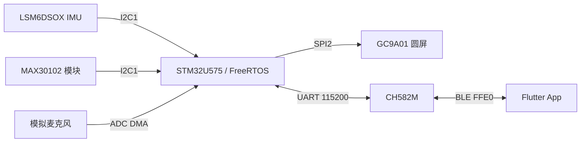

# SmartWatch 智能手表

基于 **STM32U575 + CH582M + Flutter** 的智能手表项目，包含主控固件、蓝牙协处理器固件、手机 App 和 PCB 原生设计工程。主要功能为活动识别、心率与血氧估算、睡眠分析、语音关键词检测、运动记录、个性化训练与 BLE 同步。

**当前状态：** 两份固件和 Android Debug APK 已构建通过，App 与生产 C 主机测试通过；实板供电正常，既往烧录异常待定位，完整真机功能验收尚未完成。AI 层参数和识别效果需要真机数据验证。后续后训练统一采用 **proto（原型学习）** 路线。

## 图解教程

[HTML 教程入口与打开方法](tutorial/README.md)：面向已有 C 基础的嵌入式初学者，按具体问题、图解、独立实验和项目实践展开。第一章为裸机开发，第二章为 FreeRTOS，含配套与拓展共 29 篇；五条支线共 50 篇，全站 79 篇课程，配有原创图解和交互实验。v0.2.0 预览版新增 CH582M、App、AI、个性化与升级的分篇教程。

[下载教程 v0.2.0 预览版](https://github.com/Cody-ic/SmartWatch/releases/tag/tutorial-v0.2.0)，解压后打开 `tutorial/index.html` 即可离线阅读。[课程首页源码](tutorial/index.html) 在 GitHub 文件页中只展示 HTML，不会运行交互。

## 系统架构



| 部分 | 职责 | 入口与说明 |
| --- | --- | --- |
| STM32 主控 | 采集、模型推理、界面、运动与安全状态、应用协议 | [主控固件](firmware/stm32/README.md)，入口 `Core/Src/main.c`、`app.c` |
| CH582M | BLE 外设、GATT 与 UART 字节流桥接 | [蓝牙固件](firmware/ch582m/README.md)，入口 `src/Main.c`、`peripheral.c` |
| Flutter | 连接、仪表盘、训练会话、备份、联系人和告警 | [手机端](app/flutter_app/README.md)，入口 `lib/main.dart` |
| PCB | 四层圆形板、显示/传感器接口、供电和下载接口 | [硬件设计](hardware/README.md) |

CH582M 负责字节桥接，STM32 与 App 负责应用帧解析。BLE 包边界不等于应用帧边界；三端需使用配套版本，原型备份/恢复采用 v2 协议。

## 仓库结构与阅读顺序

```text
firmware/
  stm32/
    README.md          主控结构、任务、构建和维护
    PROTOCOL.md        BLE/串口消息与原型传输规范
    AI/README.md       模型接口、真机数据与 proto 后训练
    Core/              主控应用、传感器、界面与协议
    Drivers/           CMSIS、STM32 HAL
    Middlewares/       FreeRTOS、LVGL、ST AI 运行时
    tests/host/        生产 C 功能回归
  ch582m/README.md      蓝牙桥接、构建与连接排障
app/flutter_app/
  README.md            App 构建、操作流程与实现边界
  lib/                 Flutter 业务代码
  test/                协议和界面测试
hardware/
  README.md            器件、引脚、供电与下载接口
  PCB_REVIEW.md        PCB 详细检查项
  pcb/                 嘉立创原生工程
CHANGELOG.md           软件修复记录
```

先阅读本页了解功能和状态，再进入对应模块 README。消息字段、传输时序及 PCB 接线检查保留为独立文件，便于专项查阅。

## 获取与构建

```sh
git clone https://github.com/Cody-ic/SmartWatch.git
cd SmartWatch
```

| 工程 | 环境 | 首次构建 | 产物 |
| --- | --- | --- | --- |
| STM32 | STM32CubeIDE 2.1.0 / GNU Arm 14.3.rel1 | 导入 `firmware/stm32/`，执行 Build | `Debug/SmartWatch.elf` |
| CH582M | MounRiver Studio 2 / RISC-V Embedded GCC | 导入 `firmware/ch582m/`，执行 Build | `obj/CH582M.elf`、HEX |
| App | Flutter / Dart、Android SDK、Java 17 | 执行下列命令 | Android Debug APK |
| C 回归 | MSVC Build Tools | 使用 Developer Command Prompt | 主机测试程序 |

HAL、RTOS、模型权重和必要厂商运行时随源码提供。固件构建目录由对应 IDE 首次生成，之后可用其 make/GCC 工具链构建；具体命令见各模块 README。不要直接用 CubeMX 生成代码覆盖手工外设配置。

```sh
cd app/flutter_app
flutter pub get
flutter analyze
flutter test
flutter build apk --debug
```

App 包名为 `com.example.smartwatch_app`，版本为 `1.4.0+101`。当前主要验证 Android，iOS/Windows 尚未完成平台验收；正式发行签名尚未配置。Windows 若出现 symlink 支持提示，需要启用开发者模式后重试。

## 手机端使用流程

1. 打开蓝牙并授予扫描/连接权限，扫描并选择 SmartWatch，订阅后查看 Dashboard 数据。
2. 在 Profile 设置体重、年龄并发送到手表。当前重连仍会发送默认 65 kg / 22 岁，需要重新确认参数。
3. 在 Session 选择活动，开始、结束或中止采集；原型是否更新取决于有效样本数和门控结果。
4. 通过 Proto Backup / Pull 拉取原型。恢复服务接口已实现，文件导入/导出界面仍待完善。
5. 配置紧急联系人并授予短信权限。安全事件触发 15 秒倒计时，可取消；短信“已提交”不等于实际送达。

实时血氧在无效、断连或超过 5 秒没有新有效数据后清除。睡眠报告使用最新累计时长，不叠加重复报告。完整操作和数据行为见 [App README](app/flutter_app/README.md)。

## AI 参数与 proto 后训练

当前模型包含 HAR 活动识别、KWS 关键词检测、睡眠二分类，以及 128 维 embedding 上的 7 类 proto 分类。训练集分数和现有默认阈值不能代表整机佩戴效果；采样质量、置信度门限、识别误差与参数均需结合真机数据验证和标定。

**项目约定：后续后训练走 proto。** 采集带活动标签的真机数据，提取 embedding，计算对应类别均值并做 L2 归一化，更新类别原型，再以独立采集的记录比较更新前后效果。当前 Session 实现要求目标 HAR 类别匹配、置信度至少 0.7，结束时至少有 50 个有效推理样本；这些默认门限仍需真机验证。

原型保存在 RAM，重启后需恢复或重新采集。当前 proto 个性化链路用于活动识别；睡眠、KWS 和心率/血氧参数的验证范围及数据要求见 [AI README](firmware/stm32/AI/README.md)。

## PCB 工程与硬件状态

[嘉立创原生工程](hardware/pcb/SmartWatch_V1_2026-07-09.epro2) 已提供，保留 `.epro2` 原始格式，可使用嘉立创 EDA 专业版导入或打开。

> **该 PCB 可能存在问题，尚未完成完整实板功能验证，不能视为验证通过的制板版本。** 电源能够正常工作不代表复位、充电、RTC 保持及所有外设均已验收。设计中的待核对项见 [PCB 检查记录](hardware/PCB_REVIEW.md)。

板框约 32 mm，四层铜；STM32 与 CH582M 通过 UART 通信。板上 Type-C 为供电口，没有连接 MCU USB 数据线。下载信号从 CN1 引出，详见 [引脚和下载接口](hardware/README.md)。MCU 标注差异保留为配置说明，不列为当前阻塞项。

## 功能验证

| 功能 | 当前状态 | 真机操作与通过标准 |
| --- | --- | --- |
| 开机、圆屏与按键 | 固件已实现，待上板 | 开关机与复位正常；页面显示、切换和按键响应正常，无卡死 |
| 心率与实时血氧 | 已实现；血氧过期逻辑已测试 | 正常佩戴能持续更新；移开或停止采样后约 5 秒内撤销旧血氧；重新佩戴后恢复新数据 |
| 睡眠监测 | 二分类与窗口处理已实现，相关逻辑已测试 | 完整采样后产生结果；缺失采样不使用残缺窗口；App 显示最新累计时长，不重复累加；准确性需对照睡眠记录 |
| 活动识别与运动记录 | 模型与会话已接入，效果待验 | 分别步行、慢跑、骑行、上下楼，核对类别、计步和会话记录；误识别情况单独记录 |
| LSM6DSOX 片内决策树 | ST 腕戴参考树已接入；配置加载与失败处理通过主机测试 | 观察其他/步行/跑步分类及切换延迟，同时检查 104 Hz FIFO 与 PPG 批次；参考树未经本机佩戴标定，其他类别不能认定为静止。见 [MLC 说明](firmware/stm32/Core/Inc/mlc/README.md) |
| 语音关键词与安全事件 | 已集成，效果待验 | 对“救命”“帮帮我”及日常背景声分别测试，确认触发、去抖与误报表现 |
| 蓝牙连接与数据同步 | 解析、缓冲和异常处理已有逻辑测试 | 手机连接后数据持续更新；多次断连重连无重复通知；低 MTU 下仍能完整收发 |
| 个性化采集 | 会话入口已实现，效果待验 | 选择活动并开始/结束采集，检查有效样本数与原型变化；不满足样本要求时不应错误更新 |
| 原型备份与恢复 | C/Dart 双向协议测试通过；备份有界面，文件导入/导出界面未完成 | 拉取后显示正确类别与维度；恢复需完整提交才报告成功；中断、超时或错误数据不能覆盖旧模型 |
| 血氧和睡眠的 App 显示 | 无效值、断连、过期和累计更新逻辑已测试 | 断连清除旧血氧；睡眠累计报告重复到达时，时长不增加 |
| 联系人与紧急短信 | 空列表、迁移、权限与模拟发送已测试 | 新装无演示联系人；无联系人或无权限提示原因；倒计时可取消；配置测试号码后确认真实送达 |
| 实板供电与烧录 | 供电正常；既往烧录异常未定位 | 后续复测记录烧录工具、错误信息及出错阶段，区分下载器识别、目标连接、写入和运行问题 |
| 充电、关机与续航 | 尚未完成专项验收 | 明确电芯规格后，分别测试充电电流、截止电压、温升、关机和完整续航 |

短信测试目前使用模拟通道，未向真实号码发送。Android 调用返回成功表示请求已提交，实际送达需要在接收手机上确认。iOS/Windows 未完成平台验收。


## 已有软件验证

两份固件编译通过，Flutter 静态检查通过，18 项 App 测试、11 组 C 回归及 C/Dart 双向协议互通测试通过，Android Debug APK 构建通过。

功能测试覆盖传输失败时保留旧模型、重复/乱序片与重试、血氧过期、完整睡眠窗口、FIFO 整块写入、联系人迁移、短信权限和界面状态。运行顺序见 [生产 C 回归](firmware/stm32/tests/host/README.md)，App 测试位于 [test/](app/flutter_app/test/)。

主机测试不模拟真实中断时序、无线空口和佩戴条件。真机验收需记录操作、实际表现、复现条件及参考数据；优先定位烧录异常，再验证外设、BLE 完整流程、算法效果和续航。

## 已知限制与后续工作

- **烧录：** 既往存在异常，具体原因尚未定位；按下载器识别、目标连接、写入、运行阶段分别记录报错。
- **AI：** 需要真机采样和标定，后训练按 proto 路线推进，保留独立评估数据。
- **原型管理：** RAM 原型不持久化，备份文件导入/导出界面尚未完成。
- **手机端：** 个人参数持久化、重连恢复和短信送达回调待完善。
- **模块控制：** 模块掩码可保存，但未全面控制所有子系统的运行入口。
- **硬件：** 复位/按键连接、电芯与充电参数、RTC 断电保持及续航需要专项验证。

## 参与开发

C 沿用相邻模块风格，Dart 使用 `dart format` 和 Flutter lint。协议变更同步两个固件、App、测试与 [协议规范](firmware/stm32/PROTOCOL.md)。模型改动记录真机数据条件及更新前后效果，避免仅凭编译结果判断有效性。

提交说明改动目的、影响模块和验证结果；界面改动附截图，硬件改动同步原理图和 PCB。保留第三方许可声明，不提交构建缓存、临时备份和签名密钥。修复历史见 [CHANGELOG.md](CHANGELOG.md)。
