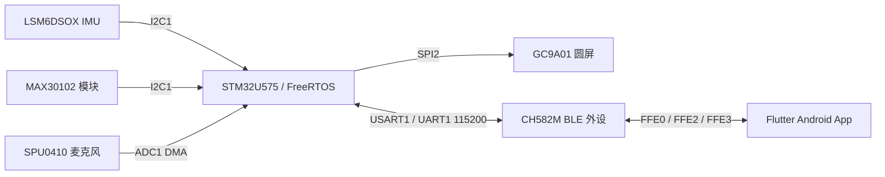

# SmartWatch 智能手表

基于 STM32U575 主控、CH582M 蓝牙协处理器与 Flutter 手机端的智能手表项目。本文档按 2026-10-23 的实际源码、构建结果和 2026-07-09 硬件文件整理。

项目覆盖活动识别、心率与血氧估算、睡眠分析、关键词检测、运动记录和 BLE 数据同步。当前阶段为**软件构建与主机回归通过，硬件待整改和上板验收**。

## 阅读导航

| 文档 | 内容 |
| --- | --- |
| [系统架构与代码导读](docs/architecture.md) | 三端分工、目录、任务、数据流、AI 模型与状态 |
| [硬件与引脚](docs/hardware.md) | 四层 PCB、器件、电源链、串口、显示、传感器及烧录接口 |
| [PCB 核验报告](docs/pcb-review.md) | 三份设计文件交叉检查、已发现接线问题、充电参数与整改条件 |
| [构建与开发](docs/build.md) | Windows 工具链、两个固件与 Flutter 的编译步骤 |
| [BLE 通信协议](docs/protocol.md) | GATT、消息格式、字段、原型传输 v2、CRC 和 ACK |
| [App 使用与行为](docs/app.md) | 连接、仪表盘、个性化、备份、联系人与短信流程 |
| [测试与验收](docs/testing.md) | 功能进度、操作步骤、预期行为与真机待验项目 |
| [故障排查与限制](docs/troubleshooting.md) | 构建、连接、数据过期、传输、Flash 型号和已知限制 |
| [维护与交接](docs/maintenance.md) | 修改约束、版本配套、发布流程、后续工作与资料索引 |
| [软件修复记录](docs/changelog.md) | 2026-10-23 的 12 项修复及验证边界 |

## 系统组成



## 功能进度

| 功能 | 当前实现与验证情况 |
| --- | --- |
| 心率、血氧与睡眠显示 | 已实现；血氧过期清除、睡眠累计值更新逻辑已测试，佩戴准确性待实测 |
| 活动识别、计步与关键词检测 | 已集成模型和应用逻辑，识别效果待真机采样验证 |
| BLE 数据同步 | 已实现串口桥接、协议解析与异常恢复；逻辑测试通过，手机与手表联调待做 |
| 个性化原型备份/恢复 | 分片、重试与失败保护已测试；App 已有拉取入口，文件导入/导出界面待完善 |
| 紧急联系人与告警 | 空联系人、权限拒绝、倒计时和短信请求流程已实现；真实短信送达待验证 |
| 电源、按键、充电与续航 | 需要先完成 PCB 整改，再进行整机验证 |

两份固件和 Android Debug APK 已构建通过，App 与生产 C 的主机逻辑测试通过。**当前没有完成烧录和真机功能验收**，构建成功不能代表传感器准确、无线通信稳定或短信已送达。具体操作与判定标准见 [功能验证](docs/testing.md)。

## 源码目录

```text
firmware/stm32/       STM32U575 主控：采集、算法、界面与应用协议
firmware/ch582m/      CH582M：BLE GATT 与 UART 桥接
app/flutter_app/     Flutter App 与 Android 短信桥接
docs/               架构、构建、协议、功能验证与维护说明
hardware/            PCB 检查结论与整改状态
```

源码包含工程配置、模型权重和编译所需的厂商依赖。使用 STM32CubeIDE / MounRiver 导入对应固件目录；手机端从 `app/flutter_app/` 运行 Flutter 命令，详见 [构建说明](docs/build.md)。第三方组件保留其原有版权与许可声明。

当前 PCB 存在 TEST 脚、复位连接及充电参数等整改项，原始设计文件暂未发布，见 [硬件状态](hardware/README.md)。

## 上手顺序

1. 阅读 [架构](docs/architecture.md) 和 [硬件核验](docs/pcb-review.md)，确认当前实现与未完成事项。
2. 按 [构建文档](docs/build.md) 配置工具链，构建三端并运行回归。
3. 原型备份/恢复使用 v2 协议，STM32、CH582M 和 App 配套更新。
4. 完成 PCB 整改与电芯选型后，再按 [验收矩阵](docs/testing.md) 开展上板验证。
