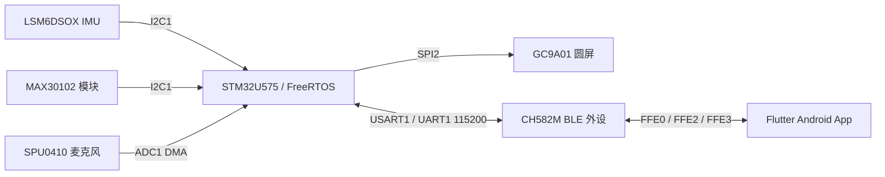

# SmartWatch 智能手表

基于 STM32U575 主控、CH582M 蓝牙协处理器与 Flutter 手机端的智能手表项目。本文档按 2026-10-23 的实际源码、构建结果和 2026-07-09 硬件文件整理。

项目覆盖活动识别、心率与血氧估算、睡眠分析、关键词检测、运动记录和 BLE 数据同步。当前阶段为**软件构建与主机回归通过，硬件待整改和上板验收**。

## 阅读导航

| 文档 | 内容 |
| --- | --- |
| [系统架构与代码导读](docs/architecture.md) | 三端分工、目录、任务、数据流、AI 模型与状态 |
| [硬件与引脚](docs/hardware.md) | 四层 PCB、器件、电源链、串口、显示、传感器及烧录接口 |
| [PCB 核验报告](docs/pcb-review.md) | 三份设计文件交叉检查、已发现接线问题、充电参数与整改条件 |
| [构建与开发](docs/build.md) | Windows 工具链、两个固件与 Flutter 的编译步骤 |
| [BLE 通信协议](docs/protocol.md) | GATT、消息格式、字段、原型传输 v2、CRC 和 ACK |
| [App 使用与行为](docs/app.md) | 连接、仪表盘、个性化、备份、联系人与短信流程 |
| [测试与验收](docs/testing.md) | 18 项 App 测试、11 组 C 回归、互通验证和真机验收矩阵 |
| [故障排查与限制](docs/troubleshooting.md) | 构建、连接、数据过期、传输、Flash 型号和已知限制 |
| [维护与交接](docs/maintenance.md) | 修改约束、版本配套、发布流程、后续工作与资料索引 |
| [软件修复记录](docs/changelog.md) | 2026-10-23 的 12 项修复及验证边界 |

## 系统组成



## 当前核验状态

| 项目 | 结果 |
| --- | --- |
| STM32 固件 | 构建通过，`text/data/bss = 900272/10292/623080` 字节 |
| CH582M 固件 | 构建通过，FLASH 143864 字节、RAM 22704 字节 |
| Flutter 静态检查 | `No issues found` |
| Flutter 测试 | 18 项通过 |
| 生产 C 主机测试 | 11 组回归断言通过 |
| C/Dart 协议互通 | 双向 fixture 验证通过 |
| Android 包 | Debug APK 构建通过 |
| 烧录、传感器实测与功耗 | 尚未完成 |
| PCB | 存在整改项，详见核验报告 |

构建通过表示当前工具链能生成产物；主机测试验证逻辑和协议。模型真实准确率、佩戴效果、BLE 空口、续航及真实短信送达均需后续验收。

## 工程位置与发布范围

本次 GitHub 仓库保存中文技术文档、软件核验摘要和硬件检查结论。参与核验的源码位于开发机的三个独立工程：

```text
D:\STM32Dev\SmartWatch           STM32 主控固件
D:\CH32Dev\CH582M               BLE 协处理器固件
D:\SmartWatchApp\flutter_app    Flutter / Android App
D:\SmartWatch_3D_Enclosure       外壳模型与测量清单
```

文档中的 `Core/`、`AI/` 等路径按所属源码工程解释；它们不是本仓库下的源码目录。构建说明需要配合对应完整工程及其厂商依赖使用。

用户提供的网表、Gerber 和嘉立创工程已检查。由于当前硬件存在 TEST 脚和复位连接等整改项，原始 PCB 文件未作为“核验通过”的制板包发布；文件指纹和结论见 [hardware/README.md](hardware/README.md)。

## 上手顺序

1. 阅读 [架构](docs/architecture.md) 和 [硬件核验](docs/pcb-review.md)，确认当前实现与未完成事项。
2. 按 [构建文档](docs/build.md) 配置工具链，构建三端并运行回归。
3. 原型备份/恢复使用 v2 协议，STM32、CH582M 和 App 配套更新。
4. 完成 PCB 整改与电芯选型后，再按 [验收矩阵](docs/testing.md) 开展上板验证。
