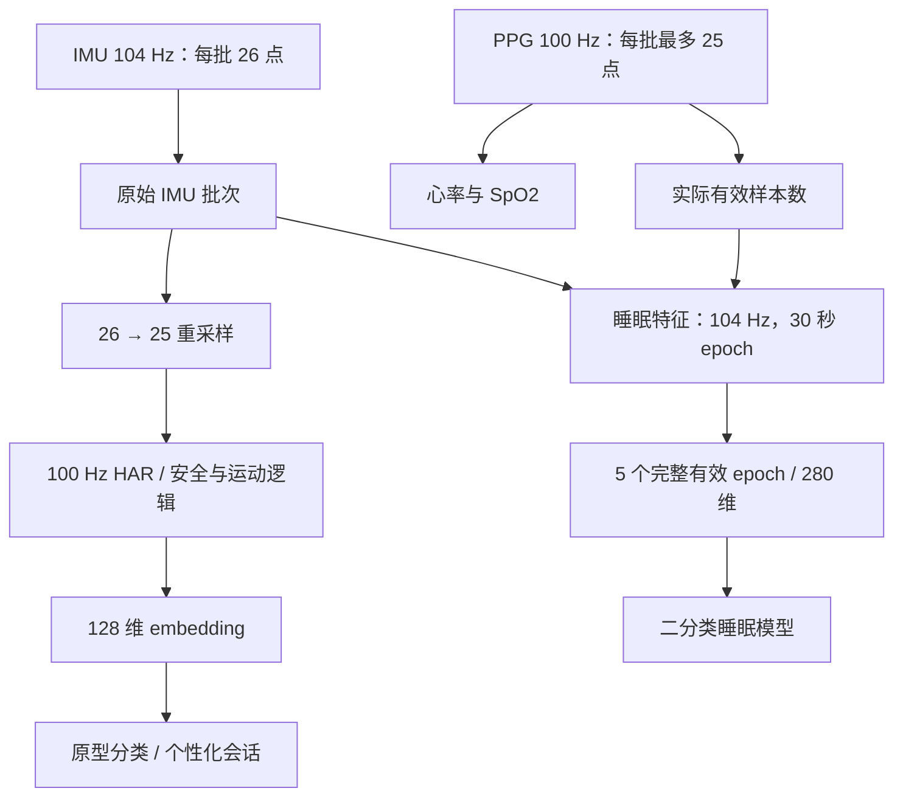

# 系统架构与代码导读

## 1. 三端职责

| 子系统 | 主要职责 | 入口 |
| --- | --- | --- |
| STM32U575 | 采集传感器、模型推理、显示、安全状态、串口协议 | `Core/Src/main.c`、`Core/Src/app.c` |
| CH582M | BLE 外设、UART 双向缓冲、GATT Write/Notify | `src/Main.c`、`src/peripheral.c` |
| Flutter | 扫描连接、数据解析、仪表盘、训练会话和联系人 | `lib/main.dart`、`lib/dashboard_page.dart` |

CH582M 是字节桥接器，不解析手表的 `0xAA` 应用帧。帧可能被多个 BLE 包拆分，也可能在一次通知中包含多帧，接收端必须保留字节流解析能力。

以下源码路径分别以 `firmware/stm32/`、`firmware/ch582m/`、`app/flutter_app/` 为根目录。

## 2. STM32 工程组织

```text
Core/
  Inc/                  公共头文件、算法状态与接口
  Src/main.c            初始化、三个 RTOS 任务、传感器主循环
  Src/app.c             应用调度、数据发布、运动与安全状态
  Src/ble_uart.c        UART 接收环、协议解析、原型会话与传输
  Src/sleep_features.c  104 Hz IMU / 100 Hz PPG 睡眠特征
  Src/task_kws.c        关键词检测任务
  Src/ui_*.c            LVGL 页面
  Startup/              启动代码
AI/                     模型包装、网络权重、原型与睡眠模型
Drivers/                CMSIS 和 STM32 HAL
Middlewares/            FreeRTOS、LVGL、ST AI 运行时等
tests/host/             实际生产 C 的主机回归与硬件 stub
Debug/                  当前 CubeIDE 构建目录
App/                    旧任务架构，当前未参与构建
```

当前 AI 编译集为 `har_embedding`、`har_model`、`har_network`、`har_network_data`、`hr_detector`、`kws_model`、`kws_network`、`kws_network_data`、`proto_model`、`sleep_model`。旧网络与旧睡眠实现有源码留存，但不能据文件名推断它们实际生效；以 `.cproject`、`Debug/AI/subdir.mk` 和链接结果为准。

## 3. RTOS 任务与线程约束

| 任务 | 优先级 | 分配栈 | 触发与工作 |
| --- | ---: | ---: | --- |
| `Sensor_Task` | 2 | 1536 words，约 6 KiB | 等待 IMU 信号量，最长等待 30 ms；采样、HAR、血氧、睡眠、应用调度和 UART 解析 |
| `Mic_Task` | 1 | 512 words，约 2 KiB | ADC DMA 音频帧、能量/ZCR 等声学事件 |
| `TaskKWS` | 1 | 1024 words，约 4 KiB | 音频积累、MFCC、DS-CNN 关键词推理与防抖 |

LVGL 操作集中在 Sensor 任务上下文。大型特征缓冲、模型状态和原型数组应放在静态存储区；新增任务局部数组前需要检查最深调用栈。链接器容量检查与主机测试无法代替设备上的栈水位测量。

主循环即使没有新 IMU 数据，也继续执行应用和 UART 处理；SpO2 超时在独立轮询路径检查，避免传感器停止后旧值永久有效。

## 4. 传感器与模型数据流



HAR 使用重采样后的数据；睡眠使用原始 26 点，避免把 100 Hz 数据按 104 Hz 解释。含缺失 PPG 的 epoch 不用于睡眠推理。五个窗口都有效后，约 150 秒积累才能得到第一份完整特征；推理就绪状态只消费一次。

## 5. 当前模型接口

| 模块 | 输入与输出 | 维护重点 |
| --- | --- | --- |
| HAR | 6×512 量化输入；7 类输出 | `har_model` 包装 ST AI 网络，匹配量化参数和通道顺序 |
| KWS | 1280 元素量化 MFCC；4 类概率 | 音频为 16 kHz，类别为“救命”“帮帮我”、silence、unknown；以实际包装接口为准 |
| Sleep | 280 个 float；`[P(wake), P(sleep)]` | 当前是 108 树二分类模型，应用使用 `probs[1]` |
| Proto | 128 维 embedding；7 类余弦相似度 | 7×128 个 float 原型，提交时按类归一化 |

历史 README 中“378 维、50 树、三分类”的描述不适用于当前睡眠模型。源码注释中的训练集分数属于历史模型资料，本文不将其作为真机实测准确率。

## 6. 原型与个性化状态

`app_init()` 调用 `proto_model_init()` 清空原型；当前原型保存在 RAM。训练会话按目标 HAR 类别和置信度门控采集 embedding，结束时至少需要 50 个有效样本，随后计算均值、归一化并更新对应类别。有效样本是推理级样本，不等于 50 个原始 IMU 点；采集时长取决于推理频率和门控通过率。

恢复/训练得到的原型不会自动写入 Flash，重启后需重新恢复或采集。App 页面提供备份拉取；恢复接口已在 BLE 服务层实现，当前界面没有完整的备份文件导入/导出管理流程。不要把存在服务 API 等同于已提供完整用户入口。

## 7. CH582M 与 App 结构

CH582M 主循环为 `TMOS_SystemProcess()` 加 `app_uart_process()`。UART→BLE RX FIFO 为 4096 字节，BLE→UART TX FIFO 为 512 字节。UART1 不输出调试文本；队列空间不足时整块拒绝。

App 采用单页三标签、`setState` 和广播 Stream：

| 文件 | 职责 |
| --- | --- |
| `ble_protocol.dart` | 帧、字段、CRC32、原型载荷和备份重组，纯 Dart |
| `proto_transfer.dart` | 恢复发送、逐片 ACK、重试和最终提交判断 |
| `ble_service.dart` | BLE 扫描、连接、MTU 分块、串行写入、通知分发 |
| `dashboard_page.dart` | Dashboard / Session / Profile 与状态显示 |
| `emergency_contacts.dart` | SharedPreferences 联系人和旧示例数据迁移 |
| `emergency_alert.dart` | 15 秒倒计时、取消和短信请求 |
| `emergency_service.dart`、`MainActivity.kt` | Flutter 与 Android SmsManager 桥接 |
