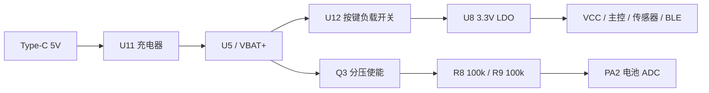

# 硬件、引脚与机械接口

## 1. 设计基线

输入文件是 2026-07-09 的 Protel 网表、嘉立创专业版工程和 Gerber。工程包含 68 个真实器件；234 个已连接器件引脚在网表、PCB 原生网络分配和 Gerber 飞针表间匹配。该结论验证网络标签对应关系，不代表铜皮电气连通性和 DRC 已通过。

Gerber 含顶层、底层和两个内层铜文件，是**四层板**。板框是直径约 32 mm 的圆形。原生工程含 219 个过孔；提取到的最小有网信号直线宽度为 5.6 mil。以上是文件统计，不能代替板厂对间距、孔环和层叠的工艺审核。

这版存在硬件整改项，请先阅读 [PCB 核验报告](pcb-review.md)。

## 2. 核心器件

| 位号 | 设计器件 | 用途与注意点 |
| --- | --- | --- |
| U1 | STM32U575RGT6 | 网表为 1 MiB Flash 的非 SMPS 型号；本地固件当前按 RITx / 2 MiB 链接 |
| U6 | CH582M | BLE 与 UART 双向桥接 |
| U2 | LSM6DSOXTR | 6 轴 IMU，I2C 与 INT1 |
| U10 | 自定义 MAX30102 模块 | 网表是 8 引脚模块接口，VIN 接 VCC；不能直接套用裸芯片引脚表 |
| MIC1 | SPU0410HR5H-PB | 模拟音频输入 |
| H2 | GC9A01 显示接口 | 1×7、2.54 mm 排针接口，显示通过 SPI2 驱动 |
| U11 | LGS4056HDA-4.35 | 当前充电截止版本为 4.35 V，需重新核对电芯 |
| U12 | XC6194AA10ER-G | 按键负载开关，TEST 脚需整改 |
| U8 | TLV76733DRVR | 3.3 V LDO |
| U14 | STM6522AAAADG6F | 按键复位监督器，现有输入/输出连接需整改 |
| U5 | 302530 电池 | 厂商、完整型号、充电上限和保护板未确认 |

显示排针 H2 与烧录 FPC CN1 是不同连接器，不能混用旧文档中对它们的描述。

## 3. STM32 接线对照

| 功能 | STM32 引脚 / 管脚号 | 代码与设计连接 |
| --- | --- | --- |
| 显示 SCK | PB13 / U1-34 | SPI2 AF5，网络历史名称仍为 `SPI1_SCK` |
| 显示 MOSI | PB15 / U1-36 | SPI2 AF5，网络历史名称仍为 `SPI1_MOSI` |
| 显示 DC | PC6 / U1-37 | H2-3 |
| 显示 CS | PC7 / U1-38 | H2-2 |
| 显示 RST | PC8 / U1-39 | H2-1 |
| BLE TX | PA9 / U1-42 | USART1 AF7 → U6-5 / CH582M PA8 RXD1 |
| BLE RX | PA10 / U1-43 | USART1 AF7 ← U6-6 / CH582M PA9 TXD1 |
| I2C SDA | PB3 / U1-55 | I2C1 AF4 → U2-14、U10-3 |
| I2C SCL | PB6 / U1-58 | I2C1 AF4 → U2-13、U10-2 |
| IMU INT1 | PB4 / U1-56 | U2-4，EXTI4 上升沿 |
| 麦克风 | PA1 / U1-15 | ADC1_IN6，MIC1-4 |
| 电池采样 | PA2 / U1-16 | ADC1_IN7 注入通道，R8/R9 分压 |
| 分压使能 | PA4 / U1-20 | Q3 栅极，拉低使能、回高阻关断 |
| 按键 KEY1 | PC0 / U1-8 | SW4 与 U14 相关网络 |
| 按键 KEY3 | PC1 / U1-9 | 经 D3 与 SW6 相关；不是 SW6 无条件直连 |
| 电源控制网 CTRL | PC2 / U1-10 | 接 U12 SHDN；旧 `power.c` 停用，当前不据此执行软件关机 |

网络名 `LPUART1_TX/RX` 也是历史名称，实际代码使用 USART1。维护时同时核对物理管脚、外设 AF 与网络连接，不能只依据网络名。

## 4. 传感器与显示接口

LSM6DSOX 使用 7 位地址 0x6A，HAL 地址通常左移为 0xD4；MAX30102 使用 0x57 / 0xAE。SDA、SCL 的 R16、R12 均为 4.7 kΩ 上拉至 VCC。IMU 设计速率为 104 Hz，PPG 为 100 Hz。

H2 的 1–7 脚依次连接显示 RST、CS、DC、MOSI、SCK、GND、VCC。确认具体显示模块插接方向和供电，PCB 网络标签本身不验证模块内部电路或机械朝向。

## 5. 电源链与电池测量

`battery.c` 通过注入转换与麦克风常规 DMA 共用 ADC1，测量后让 PA4 回到高阻。电量百分比是 3.7–4.2 V 区间的线性粗略估计，不能作为电芯充电保护，也不适合直接代表 4.35 V 电芯的完整电量曲线。

Type-C 为 6P 供电连接器，CC1/CC2 通过各自 5.1 kΩ 下拉接地。网表中没有把 USB D+/D− 接入 STM32 或 CH582M；因此不能假定插这只 Type-C 就能使用 ADB 或 USB 固件下载。

## 6. 烧录接口 CN1

| CN1 脚 | 网络 | 连接 |
| ---: | --- | --- |
| 1 | GND | 两个下载器的参考地 |
| 2 | SWCLK | STM32 PA14 |
| 3 | SWDIO | STM32 PA13 |
| 4 | CPB15 | CH582M PB15 / TCK |
| 5 | CPB14 | CH582M PB14 / TIO |

CN1 是 5P、0.5 mm FPC 接口。它没有 NRST 和 VTREF/3.3 V；下载器参考电压需要从经确认的 3.3 V 测试点引出。目标板需要供电，不能把供电缺失当作固件烧录失败。当前接口不具备直接使用 under-reset 连接的完整信号条件。

## 7. 外壳配合

本地外壳工程含 OpenSCAD、STL、预览和 `MEASUREMENT_CHECKLIST.md`。外壳设计需要复核电池真实包络（含 PCM、焊片和导线）、屏幕/排针高度、Type-C 和 FPC 位置、PPG 朝腕开窗与天线周边空间。现有外壳尺寸来自设计数据，尚未完成实物装配验证。
