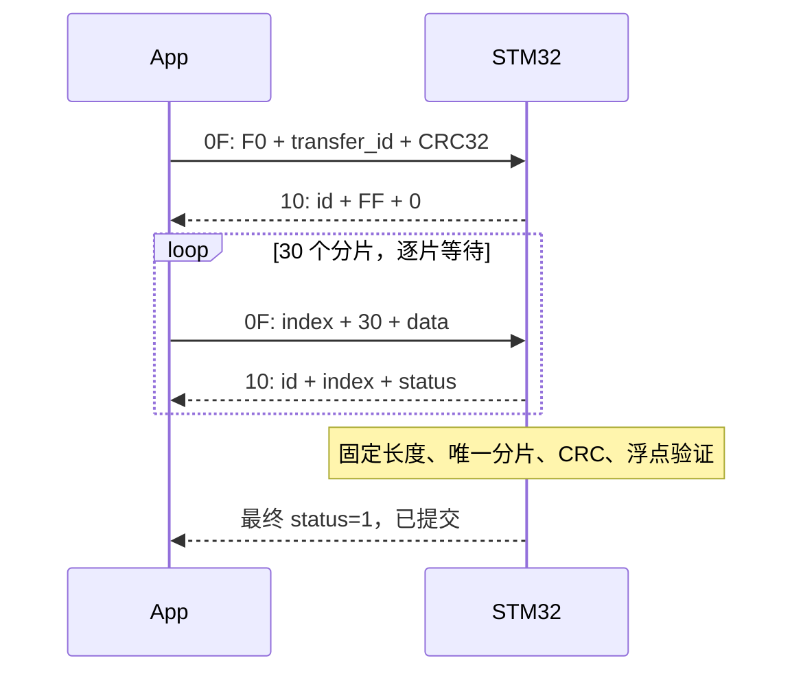

# BLE 与串口应用协议

## 1. GATT 与字节流

| 项目 | UUID / 配置 | 方向 |
| --- | --- | --- |
| Service | `0000FFE0-0000-1000-8000-00805F9B34FB` | 服务 |
| RX | `0000FFE2-0000-1000-8000-00805F9B34FB`，Write / Write Without Response | 手机 → CH582M → STM32 |
| TX | `0000FFE3-0000-1000-8000-00805F9B34FB`，Notify | STM32 → CH582M → 手机 |
| 广播名 | `SmartWatch` | 名称位于 Scan Response |
| MCU 串口 | STM32 USART1 ↔ CH582M UART1，115200 | 全双工 |

CH582M 请求 ATT MTU 247，实际以协商结果为准。`BLE_BUFF_MAX_LEN=251` 对应转发临时缓冲 244 字节。App 按 `mtuNow-3` 拆分写入，并优先使用有响应 Write；UART 与 BLE 分包边界不等于应用帧边界。

## 2. 外层帧与字节序

```text
AA | type:u8 | payload_length:u8 | payload:N bytes | checksum:u8
```

payload 上限 124 字节，总帧上限 128 字节。`checksum = (-sum(header..payload)) & 0xFF`，包含 AA、type 和 length。接收端验证长度和校验后再分发，不能把一次 BLE 通知直接当作完整消息。

多字节整数及 float32 默认小端；**0x91 授时是 u32 大端**。例如 Unix=0 的授时编码是 `AA 91 04 00 00 00 00 C1`，该值仅用于解释编码。

## 3. 消息表

W=手表、P=手机；字段顺序按下表排列。以 `ble_uart.c/.h` 和 `ble_protocol.dart` 为双方实现。

| Type | 方向 | payload 与含义 |
| --- | --- | --- |
| 01 | W→P | 5B：活动类别 u8、置信度 u16/1000、保留 2B |
| 02 | W→P | 5B：平滑心率 u16/10、原始心率 u16/10、valid u8 |
| 03 | W→P | 8B：心率/声学/IMU 告警各 u8、设备 tick u32、保留 u8 |
| 04 | W→P | 17B：热量 f32、评分 f32、运动秒数 u32、活动 u8、心率 f32 |
| 05 | W→P | 16B：步数 u32、目标 u32、距离米 u16、热量 u16、保留 4B |
| 06 | W→P | 3B：电压 mV u16、电量百分比 u8 |
| 07 | W→P | 13B：严重度 u8、ODI f32、事件数 u16、最低 SpO2 u8、平均持续秒 u16、累计监测分钟 u16、isAsleep u8 |
| 08 | W→P | 5B：P(sleep) f32、isAsleep u8 |
| 09 | W→P | 5B：实时 SpO2 f32、valid u8 |
| 0A | W→P | 5B：原型活动类别 u8、置信度 f32 |
| 0C | P→W | 会话：开始 `[01,class_id]`，结束 `[02]`，中止 `[03]` |
| 0D | W→P | 15B：原型版本 u8、7 类样本计数各 u16 |
| 0E | W→P | 原型备份 BEGIN 或分片，见下文 |
| 0F | P→W | 原型恢复 BEGIN/分片，备份请求或清空命令 |
| 10 | W→P | 6B：transfer_id u32、index u8、status u8 |
| 80 | 双向 | 用户配置 `[01,weight_kg:f32,age:u8]`；模块掩码 `[02,flags:u16]`，响应回传配置 |
| 91 | P→W | 4B：Unix 秒，u32 **大端** |

活动编号：0 躺、1 坐、2 站、3 走、4 慢跑、5 下楼、6 骑行。无效/未知值应按实际消息语义处理，不能当作某个有效活动。

0x07 的 `monitorMin` 是累计监测时长，不能逐包相加；`lowestSpo2` 是历史统计，不应覆盖 0x09 实时读数。0x03 的 tick 不是 Unix 时间。

## 4. 原型数据与 CRC32

完整载荷：`[01][model_version:u8][7×128 float32 LE]`，严格为 3586 字节。每片数据上限 122 字节，片 payload 为 `[index:u8][30:u8][data]`：前 29 片各 122 字节，最后 48 字节。

CRC32 使用 IEEE 反射多项式 `0xEDB88320`，初始值 `0xFFFFFFFF`，最终取反，覆盖完整 3586 字节。已知向量 `123456789` 的结果为 `CBF43926`。CRC 用于整包完整性检查。

float32 数据在两个头字节之后，不保证 4 字节地址对齐。Dart 使用 `ByteData.getFloat32(..., Endian.little)`；C 使用 `memcpy` 读取。禁止在偏移 2 处直接创建需要对齐的 float 数组视图。

## 5. 原型恢复 v2



BEGIN payload 为 `[F0][id:u32 LE][crc:u32 LE]`；F0 位于合法分片索引 0–29 之外。ACK status：0 已接收，1 整包提交完成，2 拒绝。BEGIN 的 ACK index=FF。只有最后一片应得到提交状态 1。

App 等待 1500 ms，单帧最多尝试 3 次，重试间隔 150 ms；固件 5 秒无有效传输则会话失效。ACK 必须同时匹配事务 ID 和片索引。完全相同的重传不清空已有数据，丢失最后 ACK 时可重发末片。

新事务清除未完成数据；冲突重复、错误长度/总片数、CRC 错误或异常浮点均不替换旧模型。固件用分片位图判断完整性，不能按收到的包数判断。没有 BEGIN 的旧式恢复片段会被拒绝。

## 6. 原型备份与出厂命令

App 请求：type 0F，payload `[03][id:u32 LE]`。固件返回 type 0E：先发 `[F0][同一id][crc]`，再发 30 个分片。App 在事务、逐片长度、唯一索引、CRC 和浮点校验都通过后才发布备份，整体等待上限 12 秒。

备份串口流量为 3779 字节，CH582M RX 队列扩为 4096 字节以容纳一次完整突发。备份方向没有逐片 ACK；缺包或错误会导致本次失败，需要重新请求，仍需真机验证低 MTU、并发遥测和连续请求下的队列余量。

`0F` 的单字节 `[02]` 在当前实现中调用 `proto_model_init()` 清空 RAM 原型，不能理解为已加载训练好的通用模型。清空命令也没有原型恢复 v2 的最终提交 ACK。

## 7. 接收容量与版本维护

STM32 RX 声明 1024 字节，环形队列实际可用 1023 字节；发生溢出会丢弃损坏接收状态。CH582M TX FIFO 512 字节，写入时整块接受或拒绝；有响应 GATT Write 空间不足返回 ATT 0x11。App 的逐片 ACK 限制恢复突发量。

协议修改必须同步固件、Dart 定义、fixture 与文档。不要只改某一端的分片尺寸或将版本字节当作传输 ID。新版 STM32 和 App 必须配套使用，CH582M 同步更新有响应写入和调试配置。
