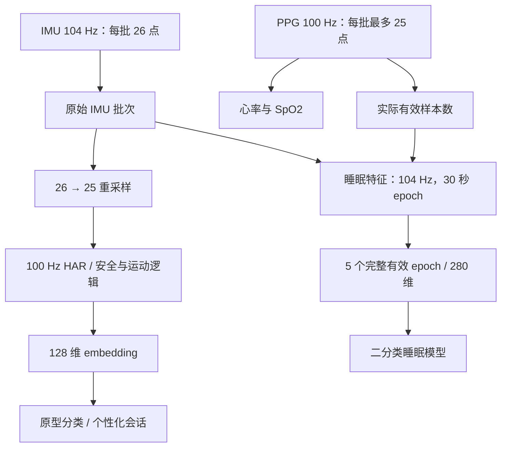

# STM32 主控固件

主控负责传感器采样、AI 推理、圆屏界面、运动与安全状态，以及和 CH582M 通信。外设使用 SPI2 显示、USART1 蓝牙串口、I2C1 IMU/PPG 与 ADC1 音频/电池采样；引脚见 [硬件 README](../../hardware/README.md)。

## 目录与入口

```text
Core/
  Inc/                  公共头文件、算法状态与接口
  Src/main.c            初始化、三个 RTOS 任务、传感器主循环
  Src/app.c             应用调度、数据发布、运动与安全状态
  Src/ble_uart.c        UART 接收环、协议解析、原型会话与传输
  Src/sleep_features.c  104 Hz IMU / 100 Hz PPG 睡眠特征
  Src/task_kws.c        关键词检测任务
  Src/ui_*.c            LVGL 页面
  Startup/              启动代码
AI/                     模型包装、网络权重、原型与睡眠模型
Drivers/                CMSIS 和 STM32 HAL
Middlewares/            FreeRTOS、LVGL、ST AI 运行时等
tests/host/             实际生产 C 的主机回归与硬件 stub
Debug/                  当前 CubeIDE 构建目录
App/                    旧任务架构，当前未参与构建
```

当前 AI 编译集为 `har_embedding`、`har_model`、`har_network`、`har_network_data`、`hr_detector`、`kws_model`、`kws_network`、`kws_network_data`、`proto_model`、`sleep_model`。旧网络与旧睡眠实现有源码留存，但不能据文件名推断它们实际生效；以 `.cproject`、`Debug/AI/subdir.mk` 和链接结果为准。

## RTOS 任务与线程约束

| 任务 | 优先级 | 分配栈 | 触发与工作 |
| --- | ---: | ---: | --- |
| `Sensor_Task` | 2 | 1536 words，约 6 KiB | 等待 IMU 信号量，最长等待 30 ms；采样、HAR、血氧、睡眠、应用调度和 UART 解析 |
| `Mic_Task` | 1 | 512 words，约 2 KiB | ADC DMA 音频帧、能量/ZCR 等声学事件 |
| `TaskKWS` | 1 | 1024 words，约 4 KiB | 音频积累、MFCC、DS-CNN 关键词推理与防抖 |

LVGL 操作集中在 Sensor 任务上下文。大型特征缓冲、模型状态和原型数组应放在静态存储区；新增任务局部数组前需要检查最深调用栈。链接器容量检查与主机测试无法代替设备上的栈水位测量。

主循环即使没有新 IMU 数据，也继续执行应用和 UART 处理；SpO2 超时在独立轮询路径检查，避免传感器停止后旧值永久有效。

## 采样与模型数据流



HAR 使用重采样后的数据；睡眠使用原始 26 点，避免把 100 Hz 数据按 104 Hz 解释。含缺失 PPG 的 epoch 不用于睡眠推理。五个窗口都有效后，约 150 秒积累才能得到第一份完整特征；推理就绪状态只消费一次。

### LSM6DSOX 片内决策树

启动时向 MLC 加载 ST 官方腕戴活动参考树，STM32 每 2 秒读取 `MLC0_SRC`，并在 `g_mlc_activity` 中保存其他/步行/跑步分类。MLC 使用 26 Hz、52 样本窗口；IMU 及 FIFO 仍为 104 Hz，保持现有 HAR、睡眠与 PPG 批次处理。分类和 wake-up 都采用轮询，INT1 仅用于 FIFO 水位。

“其他”包含非走跑动作，不能当成静止。屏幕空闲计时继续使用独立 wake-up 超阈值事件，走跑分类可恢复亮度；无效分类或通信失败时恢复亮度并重计时。模型来源、许可、104 Hz 适配与设备验证步骤见 [MLC 配置说明](Core/Inc/mlc/README.md)。当前已接入参考树，分类效果尚未完成本机佩戴验证。


## 构建

使用 STM32CubeIDE 2.1.0 导入本目录，执行 Build，首次生成 `Debug/`。将 IDE 自带 GNU Arm 14.3.rel1 和 make 的目录加入 PATH 后，在本目录运行：

```sh
make -C Debug -j8 all
# 需要全量重编译时：
make -C Debug clean
make -C Debug -j8 all
```

产物为 `Debug/SmartWatch.elf`。当前链接脚本 `STM32U575RITx_FLASH.ld` 配置 FLASH 2048 KiB、主 RAM 768 KiB，保留现有配置。PCB 标注型号差异不作为当前阻塞项。

## 生成代码与模型维护

`SmartWatch.ioc` 按现有代码同步引脚、时钟、ADC/DMA、中断和 FreeRTOS 参数，作为配置参考。RTC、看门狗、任务创建及电池采样时的 GPIO 切换仍由应用代码管理；保留现有 SPI2 双线 HAL 设置与 SCK/MOSI 接线。维护配置时直接修改 `.ioc` 并对照代码，不执行 Generate Code 覆盖工程。引脚修改同时核对 `main.h`、GPIO、SPI、I2C、USART、IRQ 和硬件设计。

当前模型接口、真机参数和 proto 后训练约定集中在 [AI/README.md](AI/README.md)。旧模型文件仍有留存，编译范围以 `.cproject` 的排除配置为准，避免把旧 `network*.c` 与当前网络同时纳入。`App/` 是未参与当前构建的旧任务架构。

## 通信与数据状态

USART1 与 CH582M UART1 使用 115200、8N1。应用帧最大 128 字节，接收按连续字节流处理；原型备份/恢复采用带事务与确认的 v2 协议。具体类型、字段、字节序及重试见 [PROTOCOL.md](PROTOCOL.md)。

`ble_uart_is_connected()` 使用最近串口收包超时推断链路，与手机 GATT 连接状态不同。主循环在没有新 IMU 数据时仍处理应用与 UART，并独立检查 SpO2 过期，避免旧值持续显示。

## 测试与烧录排障

生产 C 回归直接编译当前实现，运行方法见 [tests/host/README.md](tests/host/README.md)。已通过主机逻辑测试的项目不代表真机功能已验收，完整功能标准见 [仓库首页](../../README.md#功能验证)。

实板供电正常，既往出现过烧录异常，原因待定位。STM32 使用 ST-LINK SWD；CN1 没有引出 NRST/VTREF，下载器接线和复位方式见 [硬件接口](../../hardware/README.md)。先区分下载器识别失败、目标连接失败、写入失败和写入后不运行，再记录对应错误。`No ST-Link detected` 只能说明工具未识别下载器，不能直接判断目标板或固件有故障。

若链接报网络重复符号，检查 AI 排除列表；若生成代码后显示或采样失效，先核对手工引脚映射是否被覆盖。设备端还需测量任务栈水位、堆余量、长时间运行和传感器采样质量。
